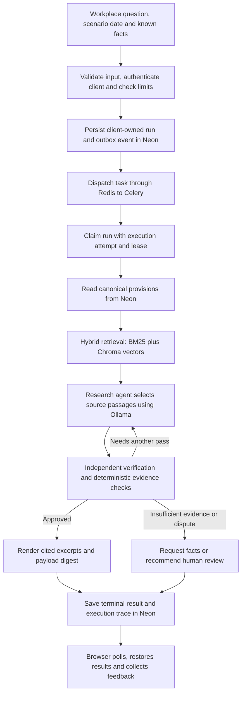
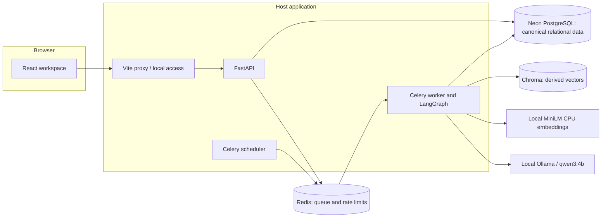

# Workplace Compliance Advisory Desk

A local research application for Indian workplace compliance. Enter a workplace question and the date to assess, then review statutory passages, citations and the recorded research process. The current source collection covers selected gratuity, maternity-benefit and POSH provisions.

**Demo:** http://127.0.0.1:4010/  
**Question guide:** [36 demo questions and the question template (PDF)](docs/demo-questions.pdf)

## Start the configured project

From the project root:

```bash
cd frontend
npm run dev
```

Keep the terminal open. The command prepares local workspace access, starts or reloads the API, Celery worker and scheduler, and starts Vite. No token needs to be typed into the local browser. If the frontend is already running, press Ctrl+C before restarting it.

The launcher detects changed root `.env` settings and backend source code. It manages only its recorded processes and preserves unrelated applications. Redis, Chroma and Ollama must be available separately.

| Service | Host development address |
|---|---|
| Browser / Vite | `http://127.0.0.1:4010` |
| FastAPI | `http://127.0.0.1:8010` |
| API documentation | `http://127.0.0.1:8010/docs` |
| Liveness / readiness | `/health` and `/ready` on the API |
| Prometheus metrics | `http://127.0.0.1:8010/metrics/` |
| Chroma, with the supplied Compose mapping | `http://127.0.0.1:8002` |
| Redis, with the supplied Compose mapping | `127.0.0.1:6380` |
| Host Ollama | `http://127.0.0.1:11434` |

## How to ask questions

Use ordinary English. There is no special command syntax.

**Pattern:** situation + known facts + specific question + request for statutory sources.

> An employee completed an 18-month written fixed-term contract. Is gratuity payable, and which statutory provisions apply?

For that demo, use scenario date **16 November 2026**, topic **Gratuity**, employee headcount **100**, and establishment type **Not specified**. Leave unknown employment dates blank. The question field accepts 10–2,000 characters. Employment start must not follow the scenario date; employment end must not precede start. A planned end may be in the future.

Enter headcount in its form field when it matters, even if it is also mentioned in the question. Do not add personal names or invent missing facts. [The PDF](docs/demo-questions.pdf) contains 36 questions, a field guide and five core demo prompts checked through the real services.

### Outcomes

- **Source passages verified:** cited excerpts passed the application's evidence checks. Inspect the passage, recorded source and qualifications.
- **More information needed:** provide the missing fact and submit again.
- **Legal review recommended:** evidence is insufficient, the question is outside coverage, or a contentious issue needs qualified human review. No referral is sent.

A technical failure is shown separately. A saved `FAILED` inquiry remains history; submit a new inquiry after fixing the cause. Refresh restores a saved result and does not rerun it.

## Workflow



1. The browser sends the question and facts through the local Vite proxy. Automatic development credentials remain on the proxy server.
2. FastAPI validates the request, enforces client ownership and Redis limits, and handles idempotency. Rejected content is quarantined using bounded, redacted fingerprints.
3. A Neon transaction stores the inquiry and an outbox event. Celery receives the run through Redis; the scheduler reconciles pending work.
4. The worker claims an execution attempt, reads the canonical statute snapshot, and combines lexical and vector retrieval. Every passage is checked against the scenario date.
5. The research agent selects evidence. The verifier checks relevance and qualifications. Research is bounded to three passes. Unknown model-generated source IDs are rejected.
6. Approved excerpts are checked against canonical text and a digest before rendering. The completed result, citations and trace are stored in Neon.
7. The browser polls for completion. Users can inspect sources, cancel active work, restore results after refresh and save feedback.

## Architecture



**Neon PostgreSQL owns relational data.** Chroma contains a derived search index; it is not the source of inquiry history or canonical statutory text. Redis supplies task transport, worker presence and counters. Ollama performs local inference without a hosted API key.

| Technology | Purpose |
|---|---|
| React 18, JavaScript, HTML and CSS | Inquiry form, outcomes, source dialogs, execution record and feedback |
| Vite 5 | Development server, build and same-origin proxy |
| Python 3.12, FastAPI, Uvicorn | HTTP API and request handling |
| Pydantic 2 / pydantic-settings | Contracts, field validation and root environment settings |
| SQLAlchemy 2 / Alembic | Async persistence, transactions and additive migrations |
| asyncpg / async Psycopg | PostgreSQL drivers; optional DNS-assisted verified connection |
| Neon PostgreSQL | Runs, attempts, outbox, canonical provisions, quarantine and feedback |
| Redis 7 / Celery 5 | Background work, reconciliation, presence and rate limiting |
| LangGraph | Bounded research and independent verification workflow |
| Ollama / qwen3:4b | Configured real local language model |
| Sentence Transformers / all-MiniLM-L6-v2 / CPU PyTorch | Real 384-dimensional local embeddings |
| BM25 / reciprocal rank fusion / ChromaDB | Lexical, semantic and combined retrieval |
| Prometheus client / structured logs | Runtime counters, timing, correlation IDs and diagnostics |
| Docker Compose / Nginx | Optional container deployment and frontend reverse proxy |
| pytest / Node test runner / Playwright | Backend, access-policy, browser and integration checks |

### Relational tables

| Table | Stored information |
|---|---|
| `canonical_provisions` | Statutory text, coordinates, effective dates, provenance and content hash |
| `compliance_runs` | Client-owned question, facts, lifecycle, citations and outcome |
| `execution_attempts` | Worker attempts, lease/fencing information and execution metrics |
| `outbox_events` | Durable dispatch and reconciliation records |
| `quarantine_records` | Bounded, redacted invalid-input records |
| `feedback_records` | Owner-scoped outcome feedback |

## Output screenshots

These are actual application screenshots from real-service verification. Fixture and earlier failure evidence is retained under `tests/evidence/`.

### Connected workspace


### Completed gratuity inquiry


### Mobile result


[Full desktop result](tests/evidence/exact-inquiry-desktop-2.png) · [Full mobile result](tests/evidence/exact-inquiry-mobile-2.png)

## Fresh installation

Requirements: Python 3.12+, Node 20+, an existing Neon database, local Ollama, and Redis/Chroma. The supplied Compose configuration can provide Redis and Chroma. Initial dependency and model downloads need internet access.

From the project root:

```bash
python3 -m venv .audit-venv
.audit-venv/bin/python -m pip install -r backend/requirements-local.txt
cd frontend
npm ci
cd ..
```

For a fresh checkout, create the root `.env` from `.env.example`. Preserve an existing working `.env`. Set `DATABASE_URL` to the private Neon PostgreSQL URL with TLS enabled. The development launcher generates a missing local-demo client key without displaying it.

Configure real local inference and retrieval:

```dotenv
LLM_PROVIDER=ollama
LLM_MODEL_NAME=qwen3:4b
OLLAMA_BASE_URL=http://127.0.0.1:11434
OLLAMA_THINK=false
OLLAMA_TIMEOUT_SECONDS=45
OLLAMA_CONTEXT_TOKENS=16384
RETRIEVAL_MODE=hybrid
LOCAL_WORKER_CONCURRENCY=1
RUN_TIMEOUT_SECONDS=90
QUEUE_WAIT_TIMEOUT_SECONDS=90
RESPONSE_DEADLINE_SECONDS=180
```

Install the model if needed:

```bash
ollama pull qwen3:4b
```

Keep Ollama running; use `ollama serve` only if no existing service is listening. For the supplied local dependency containers:

```bash
docker compose up -d redis chroma
```

Compose maps Redis to host port 6380 and Chroma to 8002; configure the matching host values from `.env.example`. The normal launcher does not start these dependency containers or the Ollama daemon.

Apply additive schema migrations explicitly:

```bash
cd backend
../.audit-venv/bin/python -m alembic upgrade head
cd ..
```

Import the supplied selected source corpus explicitly when preparing an empty deployment:

```bash
cd backend
../.audit-venv/bin/python -m ingestion.cli
cd ..
```

The importer now defaults to `data/verified/`, containing the structured corpus and provenance files. It commits canonical upserts to Neon before indexing Chroma. Empty/conflicting input is rejected. Legacy raw transcripts remain under `data/raw/`; importing raw text additionally requires an explicit verified source manifest. Startup never resets tables or automatically imports sources.

Then start the frontend with `cd frontend` and `npm run dev`.

### Environment and privacy

- The application reads the root `.env` regardless of the backend working directory. Never put private credentials in frontend build variables or commit `.env`.
- Local automatic workspace access is restricted to permitted localhost requests. Direct API and production access still require operator-issued bearer credentials and enforce client ownership.
- The configured workstation uses owner-approved `DATABASE_DNS_RESOLVER=cloudflare` because its system DNS intermittently failed to resolve Neon. Only the database hostname is sent in a binary HTTPS DNS request. PostgreSQL keeps verified TLS, the original hostname and required channel binding. No machine-wide DNS setting changes.
- Other installations default to `DATABASE_DNS_RESOLVER=system`; enable the alternative only when that hostname disclosure is authorized.
- `LLM_PROVIDER=stub` is an explicitly labeled simulator. Ollama is the real local provider configured for this demo. Hosted-provider use is separate and is not enabled by these instructions.

## API overview

| Method | Path | Purpose |
|---|---|---|
| GET | `/` | Service identity and links |
| GET | `/health` | Liveness without a schema mutation |
| GET | `/ready` | Database/corpus, Redis, worker, Chroma and auth readiness |
| GET | `/api/v1/workspace` | Authenticated workspace identity |
| POST | `/api/v1/queries` | Validate and durably accept an inquiry |
| GET | `/api/v1/runs/{run_id}` | Poll lifecycle, citations and stored outcome |
| POST | `/api/v1/runs/{run_id}/cancel` | Cancel owned queued/running work |
| POST | `/api/v1/feedback` | Save feedback on an owned terminal run |
| GET | `/api/v1/feedback/summary` | Owner-scoped aggregate feedback |
| GET | `/docs` | Interactive API documentation |
| GET | `/metrics/` | Prometheus metrics |

Protected routes require `Authorization: Bearer <operator-issued-token>`. The `Idempotency-Key` header supports safe inquiry replay; conflicting payloads return 409. Missing/invalid credentials return 401. Cross-owner record requests return 404.

## Project structure

```text
Project/
├── README.md                    # Single project guide
├── docs/demo-questions.pdf       # 36-question printable demo guide
├── frontend/                    # React/Vite workspace and proxy
├── backend/
│   ├── app/                     # API, configuration, schema and persistence
│   ├── worker/                  # Celery, agents, guards and research tools
│   ├── retrieval/               # BM25, vector search, fusion and temporal checks
│   ├── ingestion/               # Parsing and canonical/vector import
│   ├── prompts/                 # Versioned research and verification prompts
│   └── migrations/              # Additive Alembic revisions
├── data/
│   ├── verified/                # Structured source corpus, PDFs and provenance
│   └── raw/                     # Original reference transcripts
├── scripts/                     # Local startup, access preparation, source preparation
├── tests/
│   ├── backend/                 # Backend regression suite and load test
│   ├── frontend/                # Browser fixtures and Node policy checks
│   ├── integration/             # Real database/model/browser/ownership checks
│   ├── evaluation/              # Evaluation scenarios
│   ├── stub/                    # Explicit test simulator
│   ├── Dockerfile.stub           # Simulator container build
│   ├── evidence/                # Test reports, outputs and screenshots
│   ├── requirements.txt         # Lightweight verification dependencies
│   ├── pytest.ini               # Central pytest configuration
│   └── run.py                   # Backend suite launcher
├── docker-compose.yml           # Optional container stack
└── .env.example                 # Public configuration template
```

The private `.env`, virtual environments, installed dependencies and active `.runtime/` files are preserved. Empty unrelated spreadsheet placeholders and extra project Markdown documents were removed. Necessary package files and source/provenance data were retained.

## Testing

All project test code, evaluation scenarios, diagnostic scripts and evidence are consolidated under **`tests/`**.

Backend regression suite, from the root:

```bash
.audit-venv/bin/python tests/run.py -q
```

Frontend policy checks and production build:

```bash
cd frontend
npm test
npm run build
cd ..
```

Fixture browser checks require the running frontend and installed Chrome:

```bash
.audit-venv/bin/python tests/frontend/browser_check.py
```

Read-only database probe and real local-model check:

```bash
.audit-venv/bin/python tests/integration/check_database.py
.audit-venv/bin/python tests/integration/check_ollama.py
```

The following live checks create named synthetic inquiries/feedback and require the isolated `audit-a` / `audit-b` operator identities configured for this workstation:

```bash
.audit-venv/bin/python tests/integration/check_live_responses.py
.audit-venv/bin/python tests/integration/verify_local_flows.py
.audit-venv/bin/python tests/integration/check_browser_live.py
```

They preserve user records. Destructive or load testing requires a disposable Neon branch/schema, an isolated Chroma collection and dedicated client credentials. The load script is `tests/backend/load/locustfile.py`; it is not part of normal startup.

### Verification and scope

- **122 backend tests** and **7 Node policy tests** pass; frontend production build and Ruff lint pass.
- Actual Neon schema inspection finds six expected application tables and Alembic revision `0002`.
- The exact fixed-term gratuity demo passed twice through the real browser in **47.03s** and **39.49s**, citing sections **53** and **2(34)**. Refresh, source inspection, real Ollama trace, feedback and mobile layout passed with no browser/HTTP errors.
- Other actual scenarios returned the expected governing provisions for maternity, creche and POSH; an unrelated astronomy question returned no legal citations.
- Real two-client checks cover concurrent idempotency, conflict, ownership, repeated cancellation and persisted feedback. The isolated Redis limiter/TTL check also passes.
- Current scope is a selected **48-provision** corpus. It is not a complete or continuously updated legal library. Cited excerpts do not establish an individual's entitlement. Comprehensive legal accuracy, production deployment, destructive crash recovery and load/SLO acceptance are not certified by these checks.

[Exact browser results](tests/evidence/exact-inquiry-browser.json) · [Real client flows](tests/evidence/real-client-flows.json) · [Citation checks](tests/evidence/strong-citations-pass-2.json) · [Cleanup record](tests/evidence/cleanup-summary.json)

## Troubleshooting

| Symptom | Action |
|---|---|
| Proxy `ECONNREFUSED` on 8010 | Restart `npm run dev` from `frontend`; inspect `.runtime/api.log` if startup fails. |
| Database unavailable | Confirm the private root `.env` and run `tests/integration/check_database.py`. The authorized DNS option addresses the observed resolver problem; it does not replace valid database credentials. |
| Model unavailable | Check `ollama list`, the selected model, local daemon and context/timeout settings. No simulator fallback is performed. |
| “Please fill in this field” | Enter the required workplace question. This is browser form validation. |
| Old FAILED result after refresh | Enter/review the question and submit a new inquiry. Saved history is not automatically retried. |
| Missing headcount / insufficient evidence | Provide the requested facts or use the recommended human review path. |
| Port already in use | Keep services for this project on their configured ports. The launcher refuses an unrelated API listener. |

Managed backend status/stop commands, from the root:

```bash
.audit-venv/bin/python scripts/dev_services.py status
.audit-venv/bin/python scripts/dev_services.py stop
```

The stop command affects only the launcher's recorded API, worker and scheduler; it does not stop unrelated apps, Docker dependencies or the Ollama daemon.

Backend upload verified: [Murali_backend](https://github.com/Murali-co/MLOPS_Workplace_Compliance_Advisory_Desk/tree/Murali_backend), commit `905ef02`. The published snapshot contains 43 source files plus 16 public support files. The other parts remain local. [Upload receipt](docs/backend-upload.json).
